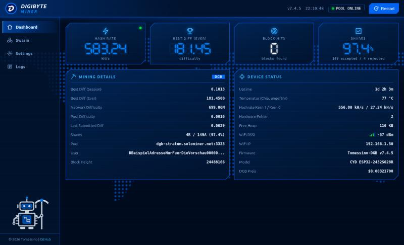
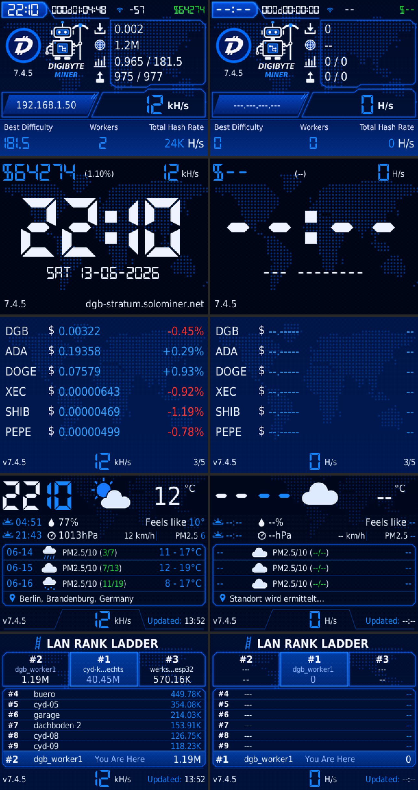

# Digibyte Miner OS

DigiByte-SHA-256d-Solo-Miner für das ESP32-2432S028R („Cheap Yellow Display“, 2,8 Zoll, 320×240, ST7789, XPT2046).



- **Rund 960 kH/s** über die SHA-Hardware des ESP32 und einen Software-Miner auf dem zweiten Kern. Am Pool über 2 Stunden gemessen: 929 ± 42 kH/s.
- **Stratum v1** mit Hauptpool und Ausweichpool, die Pool-Difficulty wird beim Start als Wunsch gesendet
- **Fünf Display-Seiten:** Miner, Uhr, Kurse mit 7-Tage-Charts, Wetter, LAN-Rang
- **RGB-LED** auf der Rückseite: feste Farbe oder Farbwechsel
- **Web-Dashboard** mit Echtzeit-Werten, WLAN, Pool, Watchlist und optionalem Passwort
- **Selbsttest beim Start:** Genesis-Hash und Vergleich der SHA-Hardware mit der Software

> **Das ist ein Lotterie-Miner.** Bei rund 960 kH/s und der aktuellen DigiByte-Difficulty dauert ein Block im Mittel über 100.000 Jahre. Akzeptierte Shares bringen im Solo-Pool keinen Ertrag. Das Projekt ist zum Basteln und Lernen gedacht.

## Schnellstart

Fertige Firmware flashen (löscht **alle** Einstellungen auf dem Board):

```bash
esptool --chip esp32 --port /dev/ttyUSB0 --baud 921600 write-flash 0x0 Tomessino-DGB-Miner-v7.7.0-firmware.bin
```

Die Datei gibt es unter den Releases des Repositorys, falls dort eine eingestellt ist. Der passende Quellcode ist dieses Repository beim Tag `v7.7.0`. Selbst bauen: [docs/INSTALLATION.md](docs/INSTALLATION.md).

Danach:
1. Mit dem WLAN `DGB-Miner-Setup` verbinden und `192.168.4.1` öffnen.
2. Eigenes WLAN und DigiByte-Wallet eintragen.
3. Die IP vom Display ablesen und das Dashboard im Browser öffnen.

Bedienung: [docs/ANLEITUNG.md](docs/ANLEITUNG.md).

## Display



Am PC gerendert mit Beispieldaten, nicht vom Gerät fotografiert.

## Stand

Getestet auf zwei Boards (beide ESP32-D0WD-V3, Revision 3.1) mit dem Pool `dgb-stratum.solominer.net`. Bis 7.6.0 lief alles auf dem ersten, 7.7.0 auf dem zweiten.

| Geprüft am Gerät | Ergebnis |
|---|---|
| Dauerlauf 30 Minuten (7.2.0) | kein Absturz, keine Trennung, 149 von 153 Shares akzeptiert |
| Lauf 12 Minuten (7.4.3) | kein Absturz, 66 von 66 Shares akzeptiert, ca. 600 kH/s |
| Dashboard unter Dauerlast (7.4.4): 410 Abrufe, nebenbei alle paar Sekunden HTTPS-Abrufe | alle vollständig, kein Neustart |
| Dauerlauf 6 Stunden (7.5.0) | kein Neustart, Pool laut Status durchgehend verbunden, 1225 von 1259 Shares akzeptiert, im Mittel 599 kH/s, freier Heap am Ende wie am Anfang (ca. 105 KB) |
| Fester Wetter-Standort (7.5.0): Ortsname geändert, unbekannter Ort, Koordinaten 953/99,5 | Ort gefunden bzw. abgelehnt, kein Neustart |
| Dauerlauf 9 Stunden (Testbau 7.6.0-t38, gleiche Mining-Schleife wie 7.6.0) | kein Neustart, 2248 von 2308 Shares akzeptiert, angezeigt rund 965 kH/s |
| Pool-Messung 2 Stunden (Testbau 7.6.0-t38) | 478 von 486 Shares akzeptiert, am Pool 913 ± 42 kH/s, mit abgelehnten 929 ± 42 kH/s, angezeigt 968 kH/s |
| WLAN-Start direkt nach einem Reset durch esptool (7.6.0) | viermal im ersten Versuch verbunden |
| Lauf 4 Minuten mit Seitenwechsel alle 5 s (7.7.0) | kein Absturz, alle 5 Seiten gezeichnet, längstes Zeichnen 95 ms, 23 von 26 Shares akzeptiert, im Mittel 968 kH/s |
| Pool-Anmeldung mit `Adresse.name` als Wallet (7.7.0) | Anmeldung angenommen, Worker heißt im LAN wie der Name hinter der Wallet |
| Jobs und Shares über das Dashboard zurücksetzen (7.7.0) | Zähler auf 0, Best Diff unverändert, kein Neustart |

**Noch nicht geprüft:**
- Laufzeiten über 9 Stunden am Stück
- Ausfälle von WLAN und Pool über längere Zeit, Wechsel auf den Ausweichpool
- Ausweichpool `eu.digi.hmpool.io`
- Dashboard-Passwort und Erfolgsfall beim WLAN-Wechsel
- Neustart nach dem Speichern im WLAN-Portal (7.5.0)
- Ob der zweite WLAN-Versuch beim Start einen Fehlschlag auffängt (7.6.0). Bisher klappte immer schon der erste.
- Best Diff über das Dashboard zurücksetzen und Speichern von Wallet-Namen oder Worker-Feld im Dashboard (7.7.0)
- Wie der Pool den Worker-Namen anzeigt (7.7.0)
- Andere Boards und Displays. Die Farbeinstellung in `setup()` gilt für das getestete Panel.

Details: [docs/TECHNIK.md](docs/TECHNIK.md), Tests: [docs/TESTS.md](docs/TESTS.md), Änderungen: [CHANGELOG.md](CHANGELOG.md).

## Lizenz

Copyright (C) 2026 Tomessino

Dieses Projekt steht unter der [GNU General Public License Version 3](LICENSE) (GPL-3.0-only). Du darfst es nutzen, ändern und weitergeben, auch kommerziell. Wer eine veränderte oder darauf aufbauende Version weitergibt, muss deren Quellcode ebenfalls unter GPL-3.0 bereitstellen. Es gibt keine Garantie und keine Haftung, im Einzelnen gilt der Lizenztext.

Das DigiByte-Logo ist davon ausgenommen. Bibliotheken und Schriften haben eigene Lizenzen: [THIRD_PARTY.md](THIRD_PARTY.md).
